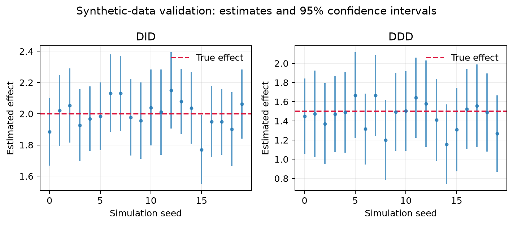
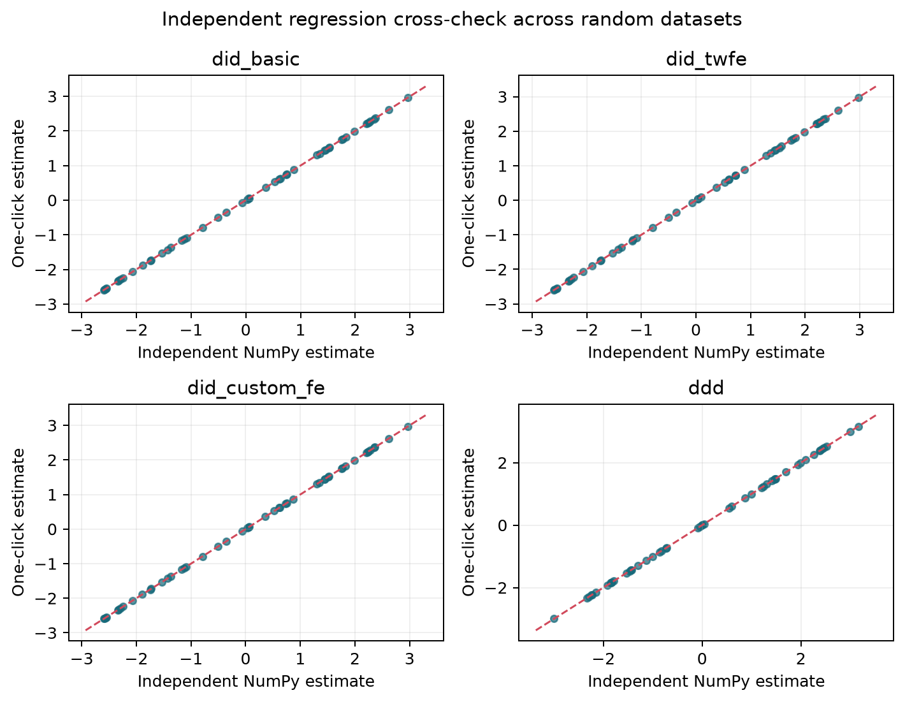

# EconDID Studio

[](https://github.com/panzehui-gh/econ-did-studio/actions/workflows/ci.yml)

[日本語 README](README_ja.md)

EconDID Studio helps applied researchers move from an untidy spreadsheet to an
auditable difference-in-differences (DID) or triple-differences (DDD) estimate.
The guided Streamlit interface is designed for users who know their research
design but do not want to write Python for every new dataset.

> The program automates data handling and estimation, not identification.
> A causal interpretation still requires defensible assumptions such as
> parallel trends, no anticipation, and an appropriate comparison group.

## What it does

- Reads CSV, TSV, and Excel files without overwriting the source.
- Trims labels, standardizes common missing markers, removes empty/duplicate
  rows, and conservatively converts numeric/date columns.
- Suggests outcome, treatment, post, entity, time, and subgroup columns using
  explainable name/type heuristics. The user confirms every mapping and which
  binary value means `1`.
- Provides four presets: basic 2×2 DID, two-way fixed-effects DID, DID with
  custom fixed effects, and DDD.
- Supports numeric controls, categorical fixed effects, HC1 or cluster-robust
  standard errors, structural diagnostics, and downloadable reproducibility
  bundles.
- Optionally creates report-ready descriptive trend charts and effect/95% CI
  charts. Each is downloadable as PNG or vector PDF.
- Includes synthetic data with known effects and Monte Carlo validation.

## Fastest start (web app)

```bash
python -m venv .venv
# Windows: .venv\Scripts\activate
# macOS/Linux: source .venv/bin/activate
python -m pip install -e .
streamlit run streamlit_app.py
```

The app opens with a deliberately messy synthetic dataset. Select **Run model**
to see a complete analysis before uploading your own file.

## Reproducible command-line use

Inspect cleaning decisions and role suggestions:

```bash
econdid inspect my_panel.xlsx
```

Run a panel DID and save cleaned data, coefficients, metadata, and the full
statsmodels summary:

```bash
econdid analyze my_panel.xlsx \
  --preset did_twfe \
  --outcome earnings --treatment treated --post post \
  --entity person_id --time year --controls age,education \
  --cluster person_id --output results
```

For nonstandard labels, explicitly set direction, for example
`--treatment-value policy_region --post-value after`.

Generate examples or rerun the numerical validation:

```bash
econdid demo --model did --effect 2 --messy --output demo.csv
econdid validate --replications 20 --output docs/validation
econdid verify --replications 50 --dirty-replications 30 --output docs/cross_validation
```

## Model presets

| Preset | Target coefficient | Typical use |
|---|---|---|
| `did_basic` | treatment × post | Repeated cross-section / simple 2×2 DID |
| `did_twfe` | treatment × post | Panel data with entity and time fixed effects |
| `did_custom_fe` | treatment × post | DID with researcher-selected categorical effects |
| `ddd` | treatment × post × subgroup | A third comparison dimension |

The formula, indicator coding, dropped-row count, cell counts, covariance type,
and full coefficient table are included in every exported result. Unknown
two-category labels are never assigned a direction silently.

## Validation

Synthetic panels are generated from data-generating processes with true DID
effect `2.0` and true DDD effect `1.5`. The validation command repeats both
estimators across random seeds and reports bias, RMSE, and 95% interval coverage.
The checked-in output is in [`docs/validation`](docs/validation).



The stronger independent cross-check reconstructs every regression design with
NumPy matrix algebra, without calling statsmodels or reusing its design matrix.
Across 200 random datasets (50 for each preset), all target coefficients and
HC1/clustered standard errors agreed within `1e-8`; the largest observed
coefficient difference was `1.32e-14`. A separate 60-run dirty-data check
randomized column order and exercised cleaning, role inference, duplicate
removal, and estimation end to end, with a 100% pass rate. Full evidence is in
[`docs/cross_validation`](docs/cross_validation).



## Development

```bash
python -m pip install -e ".[dev]"
pytest
pytest --cov=econdid --cov-report=term-missing
```

The GitHub Actions workflow runs the same suite on Python 3.12. This project is
MIT licensed. Contributions should include tests and must not add datasets that
contain personal or confidential information.

## Scope and limitations

- Current presets target a common treatment start represented by a user-supplied
  post indicator. Staggered-adoption estimators are outside the present scope.
- Automatic semantic mapping is a ranked assistant, not a substitute for the
  researcher's data dictionary.
- The trend chart is descriptive. Researchers should add design-specific
  pre-trend/event-study and robustness analyses before publication.
