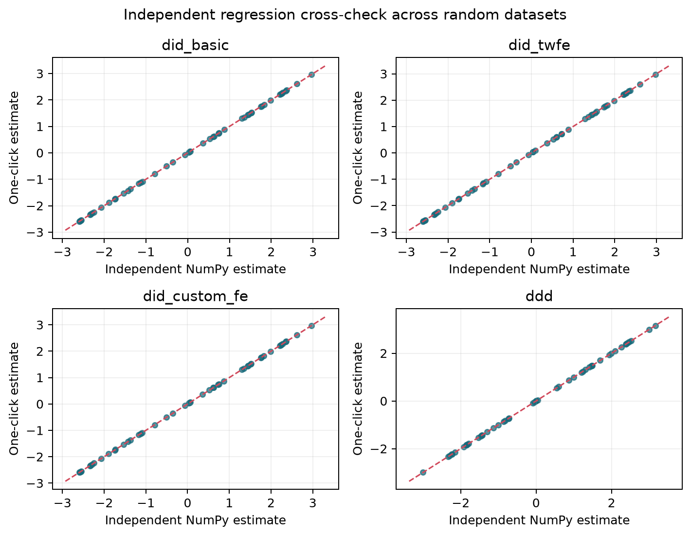

# EconDID Studio

[](https://github.com/panzehui-gh/econ-did-studio/actions/workflows/ci.yml)

[English README](README.md)

EconDID Studio は、整理されていない表形式データから、監査可能な差の差法
（DID）または三重差分法（DDD）の推定結果までを案内する研究支援ソフトです。
研究デザインは理解しているが、データごとに Python コードを書き直したくない
利用者を対象に、Streamlit の画面と再現可能な CLI を提供します。

> 本ソフトが自動化するのはデータ処理と推定であり、因果識別そのものでは
> ありません。因果解釈には、平行トレンド、先取り行動がないこと、適切な
> 比較群などの研究上の仮定が別途必要です。

## 主な機能

- CSV、TSV、Excel を読み込み、原本を上書きせずに列名・欠損値・型・空行・
  重複行を整理し、変更内容を監査ログに残します。
- 目的変数、処置、政策後、個体、時点、第三群の候補を、列名・型・値の特徴・
  利用者の説明から順位付きで提案します。最終的な対応と `1` の向きは必ず
  利用者が確認します。
- 基本 2×2 DID、個体・時点固定効果 DID、任意固定効果 DID、DDD の4種類を
  用意し、数値コントロール、カテゴリ固定効果、HC1／クラスタ頑健標準誤差を
  選択できます。
- 推定式、変数の符号化、削除行、セル数、警告、係数表、statsmodels の全文を
  保存できます。
- 希望する場合だけ、観測平均の推移図と「効果推定値＋95%信頼区間」の図を
  一括作成し、PNG または学術報告向けのベクトル PDF で保存できます。

## 最短の起動方法

```bash
python -m venv .venv
# Windows: .venv\Scripts\activate
# macOS/Linux: source .venv/bin/activate
python -m pip install -e .
streamlit run streamlit_app.py
```

起動直後には、意図的に表記を乱した合成データが表示されます。モデルと各列の
意味を確認し、**Run model** を押すだけで一連の操作を試せます。

## コマンドラインでの再現

```bash
econdid inspect my_panel.xlsx

econdid analyze my_panel.xlsx \
  --preset did_twfe \
  --outcome earnings --treatment treated --post post \
  --entity person_id --time year --controls age,education \
  --cluster person_id --output results
```

未知の2値ラベルは自動的に処置群へ割り当てません。例えば
`--treatment-value policy_region --post-value after` のように明示します。

## モデル

| プリセット | 対象係数 | 主な用途 |
|---|---|---|
| `did_basic` | 処置×政策後 | 反復横断面・基本 2×2 DID |
| `did_twfe` | 処置×政策後 | 個体・時点固定効果を含むパネル DID |
| `did_custom_fe` | 処置×政策後 | 研究者が指定したカテゴリ固定効果を含む DID |
| `ddd` | 処置×政策後×第三群 | 第三の比較軸を加える DDD |

## 数値検証

```bash
econdid validate --replications 20 --output docs/validation
econdid verify --replications 50 --dirty-replications 30 --output docs/cross_validation
```

既知効果のモンテカルロ検証に加え、statsmodels を使わない独立した NumPy の
行列計算で、4プリセットを各50回、合計200回照合しました。係数と HC1／
クラスタ標準誤差は全件で許容誤差 `1e-8` 以内に一致し、係数差の最大値は
`1.32e-14` でした。さらに、列順序の変更、文字列ラベル、重複行、型変換、
自動役割推定を含む60回の端から端までの検証も全件通過しました。数値表と図は
[`docs/cross_validation`](docs/cross_validation) にあります。



## 開発と制約

```bash
python -m pip install -e ".[dev]"
pytest
pytest --cov=econdid --cov-report=term-missing
```

GitHub Actions でも同じテストを Python 3.12 で実行します。本プロジェクトは
MIT License です。現行版は共通の政策開始時点を表す post 指標を前提とし、
段階導入専用の推定法やイベントスタディは対象外です。自動列推定は候補提示で
あり、研究者のデータ辞書と判断を置き換えるものではありません。
